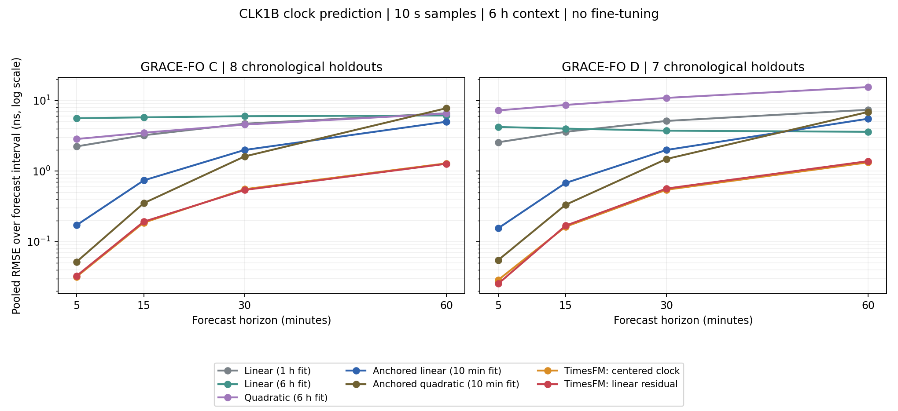

# GRACE-FO 钟差预报：本科生实验项目

[](https://github.com/Xsleet/gracefo-clock-prediction/actions/workflows/tests.yml)

从真实 GRACE-FO CLK1B 数据出发，学习“读数据 → 构造历史窗口 → 预报 → 检查误差”的完整流程。
默认用普通电脑的 CPU 运行五种多项式基线，只需要 NumPy 和 Matplotlib；进阶时可以加入 TimesFM 3.0。

**示例数据已包含，可以先离线运行基线（依赖安装需要联网）。** 本项目是三天数据的教学与研究试验，评价对事后 CLK1B 产品的预测误差，没有做实时接收机部署或全年精度认证。

## 1. 第一次运行：不需要显卡

先安装 Git 和 Python **3.11 或 3.12**。固定依赖版本面向这两个 Python 版本。

Windows PowerShell：

```powershell
git clone https://github.com/Xsleet/gracefo-clock-prediction.git
cd gracefo-clock-prediction
py -3.12 -m venv .venv
.\.venv\Scripts\python.exe -m pip install -r requirements.txt
.\.venv\Scripts\python.exe -m unittest discover -s tests -v
.\.venv\Scripts\python.exe experiment.py
.\.venv\Scripts\python.exe verify_results.py outputs/baseline
```

如果安装的是 Python 3.11，把 `py -3.12` 改为 `py -3.11`。不需要激活环境，因此不受 PowerShell 脚本执行策略影响。

Linux / macOS（`python3` 应为 3.11 或 3.12）：

```bash
git clone https://github.com/Xsleet/gracefo-clock-prediction.git
cd gracefo-clock-prediction
python3 -m venv .venv
.venv/bin/python -m pip install -r requirements.txt
.venv/bin/python -m unittest discover -s tests -v
.venv/bin/python experiment.py
.venv/bin/python verify_results.py outputs/baseline
```

成功标志：C 星 8 个有效窗口、D 星 7 个有效窗口，独立复算输出 `Verified 40 metric rows`。重复实验请使用新目录，例如 `experiment.py --output-dir outputs/run02`，程序拒绝覆盖已有非空实验目录。

| 输出文件 | 应该怎么看 |
|---|---|
| `metrics_summary.csv` | 各卫星、各方法、各预测时长的总体误差，单位 ns |
| `metrics_by_window.csv` | 每个起报点的误差，检查总体平均是否掩盖个别大误差 |
| `predictions.csv` | 每个未来历元的真值、预报值及误差，可自行复算 |
| `rmse_comparison.png` | 误差随预报时长变化；纵轴为对数刻度 |
| `example_C_forecast.png` | 固定第一个 C 星窗口的预测与误差，不按效果选图 |
| `data_audit.json`、`excluded_windows.json` | 数据缺口、钟跳、质量标记与排除原因 |
| `results.json` | 完整实验设置、软件版本和结果 |

## 2. 这个实验预测什么

目标为 CLK1B 的 `eps_time`，原单位是秒，其符号约定为：

$$t_{GPS}=t_{receiver}+\epsilon_{time}.$$

时间标签按接收机时标解释，不直接当作 UTC。每颗卫星单独预测：

```text
过去约 6 小时，2160 点                  未来 60 分钟，360 点
[历史观测........................t0] | [t0+10s, t0+20s, ... t0+3600s]
              只在左侧拟合/预处理      | 右侧用于评价，不能喂给模型
```

| 设置 | 本项目固定值 |
|---|---|
| 日产品 | 2025-06-01 至 2025-06-03，C 与 D 星 |
| 采样 | 10 s |
| 历史 | 2160 点，名义 6 h（首末观测跨度为 5 h 59 min 50 s） |
| 预测 | 一次输出 360 点，60 min |
| 起报 | 6 月 2、3 日各 00、06、12、18 时，使用接收机时间标签 |
| 指标 | 同一次 60 min 预测的 5、15、30、60 min 前缀 |
| 数据处理 | 质量标记全为 0；重叠历元取后日最后记录；不跨缺口插值 |
| 训练 | 多项式用各窗口历史拟合；TimesFM 零样本，不微调 |

默认方法：1 h 线性、6 h 线性、6 h 二次、10 min 末值锚定线性、10 min 末值锚定二次。这里“锚定”指把拟合截距调整为通过最后一个已知观测值。

为避免绝对钟差掩盖纳秒变化，先在 `float64` 中计算 `(history - history[-1]) * 1e9`。只有送入神经网络时才转为 `float32`，输出后用 `float64` 还原秒单位。

## 3. 如何阅读与自主分析

按照 [学习任务](docs/student-guide.md)完成四次实验。源代码建议按下列顺序阅读：

1. `experiment.py:load_clock`：数据每列是什么？如何发现缺测？
2. `experiment.py:prepare_history`：拟合趋势、选择历史长度、外推、恢复单位。
3. `experiment.py:make_windows`：历史与未来边界，以及窗口排除规则。
4. `experiment.py:evaluate`：RMSE、MAE、终点误差的区别。
5. `forecast.py`：只有历史输入时如何给出未来预报。
6. `timesfm_backend.py`：把同一历史窗口交给预训练模型。

实验日期和窗口长度在 `experiment.py` 顶部及 `make_windows` 中有意保持可见。本版只提供固定协议；换日期时需同时修改起报计划和输入文件名，换采样率或历史长度时还需同步修改拟合点数和绘图。先学会完整复现，再做独立分支修改，不能仅改一个数字就宣称相同实验。

## 4. 只输入历史，预测其后的 60 分钟

```powershell
.\.venv\Scripts\python.exe forecast.py data/sample/CLK1B_2025-06-01_to_2025-06-03_C.txt --satellite C --output outputs/future_C.csv
```

程序只取输入文件最后 2160 条观测，输出全部方法未来 360 点。本示例最后输入时刻为 2025-06-04 00:05:00，第一预测在 00:05:10，最后预测在 01:05:00，均为接收机时间标签。输出中没有未来真值，也不能据此计算未来误差。

使用自己的数据时，格式按 [数据说明](docs/data.md)准备。最后 2160 个点必须连续、质量标记全为 0 且 clock_id 一致；遇到缺口会报错。

## 5. 可选：TimesFM 3.0

先完成基线实验。额外需要下载约 1.32 GB 权重；模型可以使用 CPU 或 NVIDIA GPU。以下是 Windows/Linux 的 CPU 安装路径，GPU 用户按 [PyTorch 官方版本说明](https://pytorch.org/get-started/previous-versions/)选择兼容驱动的构建。

```powershell
.\.venv\Scripts\python.exe -m pip install torch==2.8.0 --index-url https://download.pytorch.org/whl/cpu
.\.venv\Scripts\python.exe -m pip install -r requirements-timesfm.txt
.\.venv\Scripts\python.exe download_model.py
.\.venv\Scripts\python.exe experiment.py --model timesfm --device cpu --output-dir outputs/timesfm
.\.venv\Scripts\python.exe verify_results.py outputs/timesfm
```

Linux 把 `.\.venv\Scripts\python.exe` 替换为 `.venv/bin/python`。Apple Silicon 可使用基线；可选 PyTorch 路径应按照官方 macOS 安装方式装 torch，不使用上述 Windows/Linux CPU 索引。

已有可用 CUDA 版 PyTorch 时，使用 `--device cuda`。已有固定版权重时可指定 `--checkpoint /path/to/checkpoint`，不必重复下载。权重通过 SHA-256 校验，推理使用 `local_files_only=True`。

本仓库固定源码提交与权重 revision，见依赖文件及 `timesfm_backend.py`。全新 CPU 基线环境和现有环境中的 TimesFM CPU/GPU 均做了验证，具体环境见 [验证记录](reference/VALIDATION.md)；不同 PyTorch 和硬件可能有小幅数值差异。

TimesFM 直接模式仍保留模型内部去趋势；外部残差模式额外减去历史拟合的直线，再把未来直线加回。模型分位数是预测区间输出，其实际覆盖率需要用留后数据计算，不能当成必然满足的置信保证。

TimesFM 3.0 权重使用独立的非商业、非生产许可证；本项目用于教学研究，权重不上传到本仓库。[数据与软件来源](DATA_SOURCES.md)

## 6. 参考结果及解释边界

下表为 60 min **整个预测区间**的 pooled RMSE，单位 ns；不是仅在第 60 分钟的误差。完整 5/15/30/60 min 数据见 [CSV](reference/metrics_summary.csv)。

| 方法 | C 星 | D 星 |
|---|---:|---:|
| 1 h 线性 | 6.6034 | 7.3982 |
| 6 h 线性 | 6.1415 | 3.6049 |
| 6 h 二次 | 6.5299 | 15.5083 |
| 10 min 锚定线性 | 5.0071 | 5.5263 |
| 10 min 锚定二次 | 7.7819 | 6.8948 |
| TimesFM 直接 | 1.2897 | 1.3306 |
| TimesFM 外部残差 | 1.2711 | 1.3866 |



这只是 3 天、两颗卫星、15 个有效窗口的探索性实验。10 min 短窗口基线在原探索实验中后补用于检查比较公平性，不是预注册的最优配置。D 星缺口附近的一个窗口被排除；跨日不连续、钟跳和质量筛选规则会影响结果。测试窗口能否完整可用属于离线评价条件，在线预报时无法预知未来产品质量。

扩大研究时应预先锁定训练/验证/测试日期和数据处理规则，不用测试集选择窗口、模型或超参数。不得把当前结果直接解释为全年能力、实时数据可用性、绝对钟差测量精度或定位精度，也不能凭不同日期的误差表宣称优于其他论文。

## 7. 仓库结构与相关项目

```text
experiment.py          固定协议的历史留后实验
forecast.py            只需历史的未来预报
prepare_data.py        官方日文件转换与来源清单
timesfm_backend.py     可选预训练模型
download_model.py      固定版权重下载与校验
verify_results.py      从 CSV 独立复算误差
data/sample/           真实教学子集和来源哈希
docs/                  数据说明、学习任务
reference/             参考结果、图和验证记录
tests/                 单位、时间对齐、缺口、泄漏及数据完整性检查
```

进阶阅读：[Darts](https://github.com/unit8co/darts)（通用时间序列库）、[PaLR-DF](https://github.com/Pony-J/PaLR-DF)（北斗钟差研究代码）、[RIME-WNN 复现](https://github.com/theoryeast/rime-wnn-bds3-clock-bias-reproduction)（MATLAB）、[TimesFM 官方仓库](https://github.com/google-research/timesfm)。它们各自的结果和数据范围不同，不能直接当成本项目的 GRACE-FO 验证结果。
