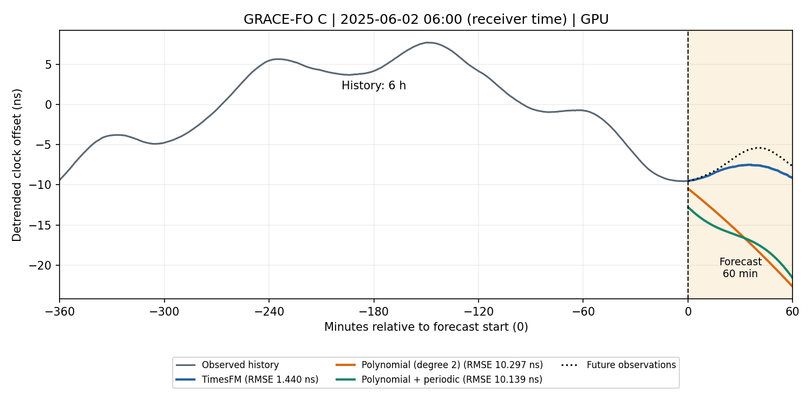

# 低轨卫星精密钟差预报Demo

**只读 [main.py](main.py) 一个文件，就能看完实验。**

面向本科生，以 **GRACE-FO C 星的真实 CLK1B 数据**为例，演示低轨卫星精密钟差预报：用**过去 6 小时的钟差，预测未来 60 分钟**，比较 **原始 TimesFM、二次多项式、二次多项式 + 周期项**。三天数据已附带，支持 **CPU/GPU 运行**及 **8 个固定窗口**对比。

默认使用 Google 官方预训练 **TimesFM 3.0**（`google/timesfm-3.0-pytorch`），没有在钟差数据上微调，也没有加载 LoRA；本例是零样本预测。模型自身的内部去趋势保留官方默认设置。

[**从 GRACE-FO 官方档案下载原始 CLK1B**](data/README.md#从官方档案下载原始数据) · [教学用 C 星 CSV](https://raw.githubusercontent.com/Xsleet/gracefo-clock-prediction/main/data/clock.csv)

```text
读数据 → 取历史 → 三种模型预测 → 与真实值比较 → 看同一张去趋势图
```

## 先看 8 个窗口的结果

用 2025 年 6 月 2–3 日每隔 6 小时的全部 8 个起报窗口做比较。**TimesFM 在 7 个窗口误差最小，多项式 + 周期项在窗口 1 最好。** 三种模型使用相同的历史和评分时刻。

| 模型 | CPU 总体 RMSE（ns） | GPU 总体 RMSE（ns） | 最优窗口数（两设备一致） |
|---|---:|---:|---:|
| 原始 TimesFM | **1.2394** | **1.2929** | **7/8** |
| 二次多项式 | 6.5299 | 6.5299 | 0/8 |
| 二次多项式 + 周期项 | 6.6145 | 6.6145 | 1/8 |

总体 RMSE 由 8 个窗口的全部 2,880 个未来点计算。起报日期只有两天。[八窗口对比图](data/window-comparison.png) · [CPU 逐窗口表](advanced/reference/windows/by_window-cpu.csv) · [GPU 逐窗口表](advanced/reference/windows/by_window-gpu.csv)

## 1. 准备

安装 Python **3.11 或 3.12** 和 Git，打开终端：

```bash
git clone https://github.com/Xsleet/gracefo-clock-prediction.git
cd gracefo-clock-prediction
python -m venv .venv
```

激活环境：Windows 命令提示符用 `.venv\Scripts\activate.bat`；Linux/macOS 用 `source .venv/bin/activate`。**下面命令均在激活后的终端执行。** PowerShell 用户可直接把 `python` 换成 `.\.venv\Scripts\python.exe`。

## 2. 选 CPU 或 GPU 运行

**普通电脑：CPU**

```bash
python -m pip install torch==2.8.0 --index-url https://download.pytorch.org/whl/cpu
python -m pip install -r requirements-timesfm.txt
python main.py --device cpu --window 2
```

**有 NVIDIA 显卡：GPU**（需要支持 CUDA 12.8 的驱动）

```bash
python -m pip install torch==2.8.0 --index-url https://download.pytorch.org/whl/cu128
python -m pip install -r requirements-timesfm.txt
python main.py --device gpu --window 2
```

CPU、GPU 使用**相同数据、相同模型**，只是运行设备不同；数值可能有细小差异。首次运行自动下载约 **1.32 GB** 模型，需要联网，无需训练。macOS 的 CPU 路径把第一条安装命令换为 `python -m pip install torch==2.8.0`。

## 3. 看两个起报窗口

上面的命令运行窗口 2。打开 `outputs/timesfm-cpu/window-02/result.png`（GPU 对应 `timesfm-gpu`）。要复现窗口 1，把 `--window 2` 改成 `--window 1`。

**一张去趋势后的图：过去 6 小时观测 → 起报虚线 → 未来 60 分钟预测。** 灰线是历史，蓝线为 TimesFM，橙线为多项式，绿线为多项式 + 周期项。黑色点线是未来真实值，仅用于比较；浅黄色区域为预测窗口。

| 起报时刻（接收机时间） | TimesFM | 二次多项式 | 二次多项式 + 周期项 |
|---|---:|---:|---:|
| 窗口 2 · 6 月 2 日 06:00 | **1.4404** | 10.2971 | 10.1391 |
| 窗口 1 · 6 月 2 日 00:00 | 1.4875 | 2.6856 | **0.9666** |

表和图是 GPU 结果，RMSE 单位为 ns。窗口 2 的真实钟差在起报后回升，TimesFM 跟住了回升，两个传统模型继续向下外推。



窗口 1 中，多项式 + 周期项的预测更接近未来观测。


三种模型使用**同一段 6 小时历史**：

| 模型 | 学生需要理解的内容 |
|---|---|
| TimesFM | 直接加载官方预训练模型，无需训练 |
| 二次多项式 | 用最小二乘拟合 `a + b*t + c*t²`，向未来延伸 |
| 二次多项式 + 周期项 | 在多项式上加 `A*sin(2πt/T) + B*cos(2πt/T)`，描述重复波动 |

`t` 是相对起报点的时间，代码中单位为小时。周期 `T` 在 **60–150 分钟**范围内按 1 分钟步长搜索。每个候选周期都用历史数据拟合上述五个系数，再选**历史拟合误差最小**的周期。

趋势是**仅用历史数据拟合的直线**。绘图时，历史、未来真值和预测统一减去这条直线及其外推值，单位为 ns。这样能看清细小变化；这一步只影响显示，不改变模型输入、预测值或 RMSE，也不是模型微调。

同目录的 `prediction.csv` 有八列：时间、真实钟差，以及三种模型各自的“预测钟差（秒）、误差（ns）”。列名带 `timesfm`、`polynomial`、`periodic` 前缀。终端和图例显示各模型 RMSE；再次运行会更新结果文件。

读代码时只跟着六个中文注释走：选设备、读数据、换单位、预测、算误差、画图。`truth` 是未来真实值，**只用于最后评分，不能输入模型**。

想先试一个不用大模型的版本：

```bash
python -m pip install -r requirements.txt
python main.py --model linear
```

这个快速示例把 TimesFM 换成最近 10 分钟的线性外推，同时保留两个多项式对照，全部运行在 CPU。其 CSV 中首个模型前缀为 `linear`。跑通后，再运行上面的 CPU/GPU TimesFM 命令，即可得到三种目标模型的比较图。

## 4. 跑完八个窗口

```bash
python compare_windows.py --device cpu
```

用 GPU 时把 `cpu` 换成 `gpu`。编号 1–4 对应 6 月 2 日的 00、06、12、18 时，5–8 对应 6 月 3 日相同小时，均为接收机时间。单窗口的图和 CSV 保存在 `outputs/timesfm-cpu/window-01` 至 `window-08`，汇总图和表保存在 `outputs/windows-cpu/`（GPU 为 `windows-gpu`）。

后续实验可通过 `--data` 换成自己的钟差 CSV，或用 `--origin` 指定接收机时刻。原始 CLK1B 转换和完整命令见 [数据与使用方法](data/README.md)。来源与许可见 [DATA_SOURCES.md](DATA_SOURCES.md)，早期实验见 [advanced/](advanced/README.md)。
