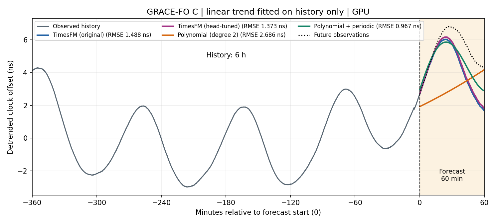

# GRACE-FO 钟差预报 · 简明版

**看预测读 [main.py](main.py)，看微调读 [finetune.py](finetune.py)。**

用 C 星**过去 6 小时的钟差，预测未来 60 分钟**，比较 **原始 TimesFM、微调 TimesFM、二次多项式、二次多项式 + 周期项**。训练和展示数据均已附带。

原始模型为 Google 官方预训练 **TimesFM 3.0**（`google/timesfm-3.0-pytorch`），未作钟差微调。微调版本**只更新最后的预测头**（737,856 个参数），其余权重冻结；这是轻量微调，没有使用 LoRA 或全参数训练。两者均保留官方默认内部去趋势设置。

```text
先用 5 月数据微调 → 用 6 月的过去 6 小时预测 → 四种模型画在同一张图上
```

## 1. 准备

安装 Python **3.11 或 3.12** 和 Git，打开终端：

```bash
git clone https://github.com/Xsleet/gracefo-clock-prediction.git
cd gracefo-clock-prediction
python -m venv .venv
```

激活环境：Windows 命令提示符用 `.venv\Scripts\activate.bat`；Linux/macOS 用 `source .venv/bin/activate`。**下面命令均在激活后的终端执行。** PowerShell 用户可直接把 `python` 换成 `.\.venv\Scripts\python.exe`。

## 2. 选 CPU 或 GPU 运行

**普通电脑：CPU**

```bash
python -m pip install torch==2.8.0 --index-url https://download.pytorch.org/whl/cpu
python -m pip install -r requirements-timesfm.txt
python finetune.py --device cpu
python main.py --device cpu --finetuned
```

**有 NVIDIA 显卡：GPU**（需要支持 CUDA 12.8 的驱动）

```bash
python -m pip install torch==2.8.0 --index-url https://download.pytorch.org/whl/cu128
python -m pip install -r requirements-timesfm.txt
python finetune.py --device gpu
python main.py --device gpu --finetuned
```

选择一种设备运行即可。首次下载约 **1.32 GB** 原始权重；然后微调 100 步，保存到 `outputs/finetune/head.pt`。之后只运行 `main.py` 的命令即可复用，CPU/GPU 都支持。两种设备使用相同数据和训练设置，数值可能有细小差异。macOS 的 CPU 路径把第一条安装命令换为 `python -m pip install torch==2.8.0`。

微调的三个步骤：**用训练数据更新预测头 → 用验证数据选最佳训练步 → 加载该预测头作四模型比较**。学习率固定为 `1e-5`，每批 4 个窗口，随机种子 2026，每 20 步验证一次。

| 数据 | 用途 |
|---|---|
| 5 月 27–30 日，63 个窗口 | 训练预测头 |
| 5 月 31 日，9 个窗口 | 选择最佳训练步 |
| 6 月 2 日 00:00 起报 | 保留原展示窗口，评价未来 60 分钟 |

训练、验证、展示的实际观测时间互不重叠；训练窗口之间允许重叠。微调代码不读取展示文件 `data/clock.csv`。这段展示数据此前已看过，因此是教学回顾实验，不是新盲测。

权重许可禁止再分发微调权重，故仓库提供数据和代码，权重由学生在本机生成，详见 [来源与许可](DATA_SOURCES.md)。只想运行之前的三模型版本，可去掉 `--finetuned`，无需训练。

## 3. 看结果

打开 `outputs/comparison-cpu/result.png`（GPU 对应 `comparison-gpu`）：

**一张去趋势后的图：过去 6 小时观测 → 起报虚线 → 未来 60 分钟预测。** 灰线是历史，蓝线为原始 TimesFM，紫线为微调 TimesFM，橙线为多项式，绿线为多项式 + 周期项。黑色点线是未来真实值，仅用于比较；浅黄色区域为预测窗口。

四种模型在预测时使用**同一段 6 小时历史**；微调模型额外使用了 5 月样本事先训练：

| 模型 | 学生需要理解的内容 |
|---|---|
| 原始 TimesFM | 直接加载官方预训练模型，无需训练 |
| 微调 TimesFM | 保留主体，只训练最后负责输出预测值的一层 |
| 二次多项式 | 用最小二乘拟合 `a + b*t + c*t²`，向未来延伸 |
| 二次多项式 + 周期项 | 在多项式上加 `A*sin(2πt/T) + B*cos(2πt/T)`，描述重复波动 |

`t` 是相对起报点的时间，代码中单位为小时。周期 `T` 在预先固定的 **60–150 分钟**范围内按 1 分钟步长搜索：每个候选周期都拟合上述五个系数，选择**历史拟合误差最小**的周期。本例选出 **93 分钟**；没有用未来真实值选择周期或系数。

趋势是**仅用历史数据拟合的直线**。绘图时，历史、未来真值和预测统一减去这条直线及其外推值，单位为 ns。这样能看清细小变化；这一步只影响显示，不改变模型输入、预测值或 RMSE，也不是模型微调。



本机实测的未来 60 分钟 RMSE（ns，越小越好）：

| 模型 | CPU | GPU |
|---|---:|---:|
| TimesFM（未微调） | 1.4563 | 1.4875 |
| TimesFM（预测头微调） | 1.3432 | 1.3733 |
| 二次多项式 | 2.6856 | 2.6856 |
| 二次多项式 + 周期项 | **0.9666** | **0.9666** |

两列分别在对应设备上完成训练和预测，图中展示 GPU 结果。微调使 TimesFM 的本窗口 RMSE 降低约 **7.7%**，但仍高于多项式 + 周期项。100 步预测头微调是入门实验，不代表 TimesFM 充分微调后的最佳能力。两个小型最小二乘对照均由 NumPy 在 CPU 上计算。

同目录的 `prediction.csv` 有十列：时间、真实钟差，以及四种模型各自的“预测钟差（秒）、误差（ns）”。前缀分别为 `timesfm`、`finetuned`、`polynomial`、`periodic`。终端和图例显示各模型 RMSE；再次运行会更新结果文件。训练过程和检查结果保存在 `outputs/finetune/training.json`。

读代码时只跟着六个中文注释走：选设备、读数据、换单位、预测、算误差、画图。`truth` 是未来真实值，**只用于最后评分，不能输入模型**。

想先试一个不用大模型的版本：

```bash
python -m pip install -r requirements.txt
python main.py --model linear
```

这个快速示例运行线性外推和两个多项式对照，共三条预测曲线；CSV 有八列，首个模型前缀为 `linear`。跑通后再尝试上面的四模型比较。

本例是一个固定窗口的入门实验，不代表全年精度。数据使用说明见 [data/README.md](data/README.md)；模型权重限教学研究等许可用途，见 [来源与许可](DATA_SOURCES.md)。完整多窗口实验放在 [advanced/](advanced/README.md)，入门时可以先不看。
